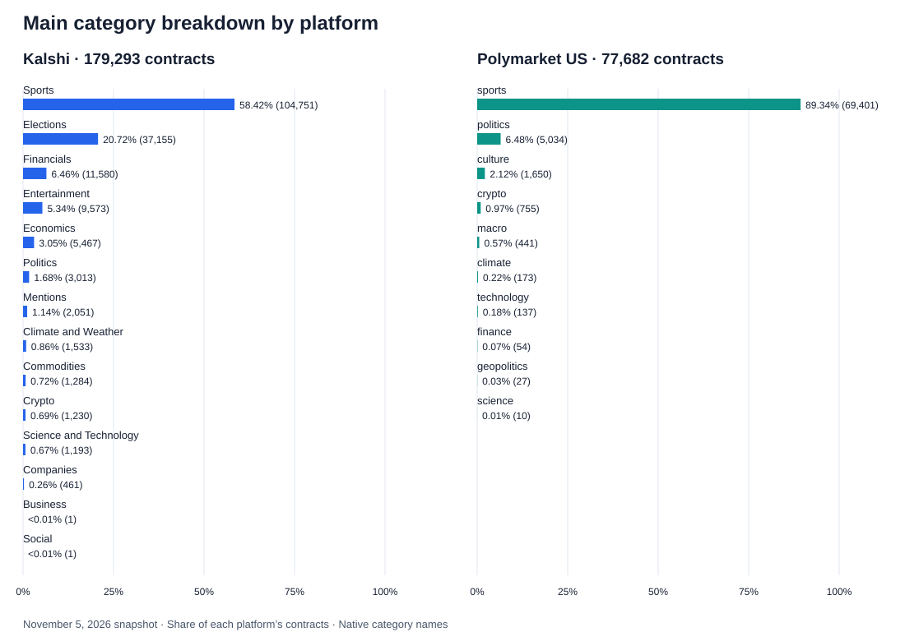

# Embedding-based market matching plan

## Goal

Find likely pairs of Kalshi and Polymarket US markets for the later match explanation and verification stages. Embedding similarity ranks candidates; it does not establish that contracts are equivalent or approved for trading.

## Proposed structure

```text
collector/                         # Existing collection and standardized profiles
embeddings/
    config/
        categories.json            # Versioned cross-platform category mappings
        sports.json                # Versioned sport tag/subcategory aliases
    prepare.py                     # Load profiles and build model input text
    embed.py                       # Generate and optionally store embeddings
    search.py                      # Rank cross-platform candidate markets
    report.py                      # Proposed: generate an HTML review report
evaluation/
    retrieval/
        cases.csv                  # Human-labeled pairs and review notes
        evaluate.py                # Retrieval metrics and missed examples
notebooks/
    explore_matches.ipynb          # Explore profiles, candidates, and results
docs/
    embeddings_plan.md             # This plan
```

This is a starting point, not a fixed design. Keep the implementation small and split files only when useful. The collector's `data/market_profiles/market_profiles.parquet` is the initial input; the saved file may be stale until the collector is refreshed. Use the existing collector and Polymarket US as the initial default.

## Approach

1. **Prepare profiles.** Load market profiles for both platforms, retain market IDs and metadata, and build consistent text from exactly three profile columns: `title` (event title), `market_title`, and `yes_means`. Handle missing fields. Keep full rules and dates available for review. Omit `summary` and event subtitles from the initial embedding input; `summary` largely repeats these fields but can also contain the Kalshi event subtitle. Revisit subtitles only if evaluation shows missing context.
2. **Generate embeddings.** Try `google/embeddinggemma-300m` locally using its recommended query/document conventions. Begin with a small sample. Record the model version and input configuration. Model access requires accepting its terms and authenticating with Hugging Face; the first download requires network access. Decide whether to cache vectors after measuring the cost of regeneration.
3. **Retrieve candidates.** Search Polymarket US profiles for each Kalshi market and rank the nearest candidates by similarity. Restrict search to corresponding broad categories using an explicit cross-platform mapping, as described below. Queries with missing or unmapped categories search the full candidate pool; candidates with missing or unmapped categories remain eligible for every query. For sports, refine by sport tags/subcategories as described below; leave other categories at the broad-category level. Display IDs, scores, titles, YES meanings, dates, and rules so people can inspect them. Avoid treating a score as a probability or a verified match.
4. **Inspect and review.** Start with the notebook to explore candidates and refine what reviewers need. Then generate a self-contained HTML report showing each Kalshi market alongside its top Polymarket US candidates, similarity scores, YES meanings, dates, full rules, and links. Initially the report can be read-only. If reviewers need to label candidates directly, add an explicit export mechanism; a static HTML page alone does not persist labels. Capture equivalent, complementary, unrelated, or uncertain decisions and notes in a reusable evaluation dataset. Initial evaluation covers pairs of binary YES/NO contracts; baskets are out of scope.
5. **Evaluate and iterate.** Create reviewed examples and measure how often a known matching market is returned in the top 5 and top 10, as well as its rank. Search against a realistic pool containing the known counterparts before category filtering, rather than only comparing labeled pairs. Count counterparts excluded by category filtering as retrieval misses and inspect those exclusions. Include difficult non-matches and review misses. Report retrieval performance separately for equivalent and complementary relationships. Compare the initial text representation with one that adds rules; keep a held-out test set separate from model and input selection. Split labeled examples by underlying event, keeping related contracts and corresponding events across both platforms in the same split. No keyword baseline is planned initially.
6. **Integrate later.** Pass candidates to the planned explanation, numeric checks, rules review, and human review stages. Determine the interface with the team before integrating with match flags or any trading workflow.

## Initial category filtering

Normalize category names for case and whitespace, then use an explicit mapping of allowed cross-platform categories. For example, map Kalshi `Sports` and Polymarket US `sports` together; map Kalshi `Politics` and `Elections` to Polymarket US `politics`; and map Kalshi `Economics` to Polymarket US `macro`. Review the remaining mappings against the collected data rather than assuming similar names are equivalent.

- A query with a mapped category searches candidates in the mapped category or categories, plus all candidates with missing or unmapped categories.
- A query with a missing or unmapped category searches all candidates.
- Leave ambiguous categories unmapped initially, so they use the broader fallback.
- Use sport tags/subcategories for sports, with broader fallbacks as described below.
- Check category-filter exclusions against known evaluation matches before tightening the mapping.

## Evaluation across the workflow

Evaluation should cover each stage and the overall system. This branch starts with retrieval: recall at K and ranks against human-labeled examples. Later stages need their own checks—for example, whether verification catches different deadlines or outcome definitions, and whether profit calculations match hand-calculated examples. End-to-end evaluation should test whether valid opportunities survive the full pipeline and false opportunities are rejected. Retrieval scores alone cannot establish contract equivalence or profitability.

## Open decisions

- Complete the broad category mapping using the collected data; leave ambiguous values unmapped.
- Choose a realistic candidate pool and initial sample size, using event-grouped development/test splits.
- Decide where cached vectors, generated reports, and results belong, and whether they should be excluded from Git.
- Decide how review labels are captured and exported, including how multiple reviewers resolve disagreements.
- Select a date-filtering strategy only after testing for false exclusions; trading close dates do not necessarily equal resolution dates.

## Proposed cross-platform category matching

Starting proposal based on the categories present in the saved November 5 profiles. These are retrieval mappings, not claims that the platforms define their categories identically. A Kalshi category may search more than one Polymarket US category.

| Kalshi category | Proposed Polymarket US candidate categories |
|---|---|
| Sports | sports |
| Politics | politics, geopolitics |
| Elections | politics, geopolitics |
| Financials | finance, macro |
| Economics | macro, finance |
| Entertainment | culture |
| Science and Technology | science, technology |
| Climate and Weather | climate |
| Crypto | crypto |
| Companies | Unmapped: search all categories |
| Business | Unmapped: search all categories |
| Mentions | Unmapped: search all categories |
| Commodities | Unmapped: search all categories |
| Social | Unmapped: search all categories |
| Missing or previously unseen category | Search all categories |

Treat this table as an explicit allowed-category mapping rather than requiring one-to-one category equality. All missing or unmapped Polymarket US categories remain eligible for every query, including any previously unseen values. Review these proposed mappings against known matches; keep broader searches where category boundaries are uncertain. Sports uses the additional refinement described below; other categories retain broad-category filtering.

## Category distribution in the initial snapshot



The saved November 5, 2026 profiles contain 179,293 Kalshi and 77,682 Polymarket US contracts. Shares use each platform's total contract count; categories retain their native names.

## Proposed sports refinement

Use Kalshi sport tags and Polymarket US subcategories/tags to restrict sports searches to the same sport. Normalize clear aliases such as Hockey/ICEHOCKEY, Table Tennis/TABLETENIS, and Tennis/ATP/WTA/doubles variants. Use tags to disambiguate broader subcategories such as COMBAT. Missing or ambiguous sport classifications fall back to all sports; unclassified sports candidates remain eligible for every sports query.

Simple keyword rules can further identify leagues from the existing three text fields, alongside Polymarket US league tags. Recognize explicit names and controlled aliases, such as NFL/National Football League, NBA/National Basketball Association, or college football. Use case-insensitive word-boundary matching; do not infer a league merely from a city name. Apply league restrictions only where classification is confident, keep candidates with unknown or ambiguous leagues eligible, and fall back to sport-level search for unclassified queries. Validate exclusions against known matches before enabling league filtering.

A conservative calculation with sport filtering gives approximately 2.97 billion pairwise comparisons, versus 7.79 billion with main-category filtering alone. This estimate combines clear sport aliases, leaves unmatched sport groups on the all-sports fallback, and does not apply league filtering.

## Mapping configuration

Store hand-maintained matching rules in `embeddings/config/` and commit them with the code, rather than placing them under `data/`. Use JSON so loading the mappings requires no additional dependency.

- `categories.json`: map normalized Kalshi categories to lists of allowed normalized Polymarket US categories, following the proposed category table above. Omit ambiguous mappings rather than interpreting an empty list as permission to exclude all candidates.
- `sports.json`: map platform-specific sport tags and subcategories to shared sport names. Keep separate sections for Kalshi tags, Polymarket US subcategories, and Polymarket US tags. Normalize keys for case and whitespace when loading.

For example, `sports.json` could start with:

```json
{
  "kalshi_tags": {
    "Football": "football",
    "Hockey": "hockey"
  },
  "polyus_subcategories": {
    "FOOTBALL": "football",
    "HOCKEY": "hockey",
    "ICEHOCKEY": "hockey"
  },
  "polyus_tags": {
    "Football": "football",
    "Hockey": "hockey"
  }
}
```

Keep fallback behavior in the search code: missing, unmapped, or conflicting classifications broaden the search according to the category and sports rules above. Validate configuration on load so malformed files fail clearly rather than silently changing candidate selection. Record the mapping revision or content hash with retrieval results.

Generated vectors, candidate results, and reports can live under `data/`; their exact subdirectories and Git exclusions remain an implementation decision.
